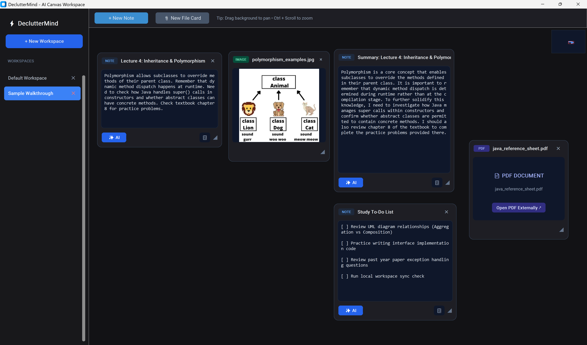
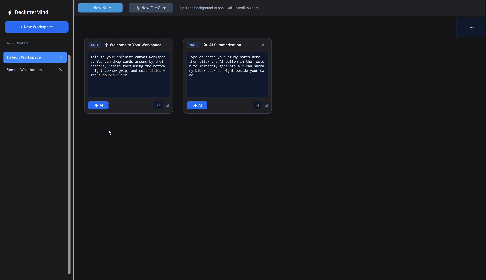
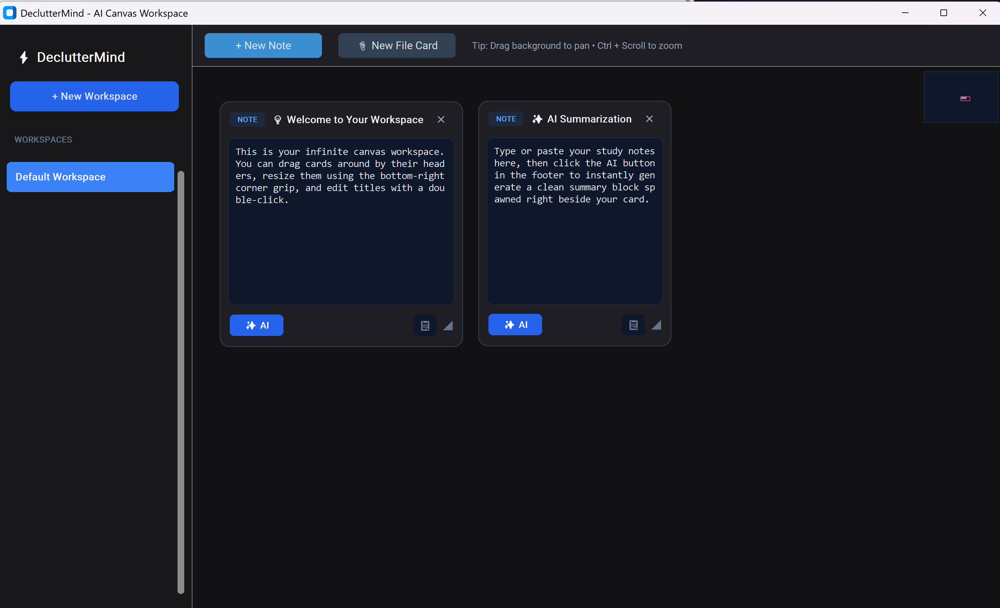

# ⚡ DeclutterMind | AI Canvas Workspace
### Your mind, decluttered. Your Study workspace, supercharged.
 

**DeclutterMind** transform your fragemented thoughts into a seamless infinite workspace



 

 

**DeclutterMind** is a modular desktop productivity suite built with Python and CustomTkinter, designed to help students and developers organize fragmented thoughts, study notes, and references onto a seamless infinite canvas.

Built with a focus on clean UX architecture, sub-second interface responsiveness, local data persistence, and integrated artificial intelligence, the application streamlines modern brainstorming and study workflows.

---

## 🚀 Core Features

### Infinite Canvas & Workspaces
* **Infinite Workspace Navigation:** Pan, zoom, and navigate seamlessly across an infinite spatial canvas with a live interactive Minimap HUD.
* **Workspace Management:** Create, rename (via double-click), and switch between multiple isolated workspaces stored locally.
* **Default Onboarding Templates:** Newly created workspaces automatically populate with interactive tutorial cards to guide users through the interface.

### AI Summarisation & Intelligence
* **Transcript-to-Notes Pipeline:** Instantaneous processing of raw notes and content via the Google GenAI SDK (`google-genai`) into clean, structured summaries.
* **Asynchronous Background Processing:** Leverages threaded execution for API requests to ensure the UI thread never freezes or blocks during generation.
* **Auto-Persistence:** Newly spawned AI summary cards are automatically captured and saved directly into local storage.

### Data Persistence & Portability
* **Local-First Storage:** All workspaces, card states, positions, and notes are automatically persisted locally to `declutter_workspaces.json` for offline access and zero server dependency.
* **File Note Integration:** Support for loading and pinning external image and PDF reference cards directly onto the workspace grid.

---

## 🛠️ Technical Stack

* **Language:** Python 3.14.0
* **GUI Framework:** CustomTkinter & Tkinter (Canvas & Toplevel widgets)
* **AI Integration:** Google GenAI SDK (`google-genai`, `gemini-3.1-flash-lite`)
* **Storage:** JSON-based flat-file local persistence (`declutter_workspaces.json`)
* **Environment Config:** `python-dotenv` for secure API key management

---

## 📁 Project Structure

```text
DeclutterMind/
│── app.py                    # Main application entry point & canvas controller
│── cards.py                  # Custom card widget definitions (NoteCard, FileNoteCard)
│── declutter_workspaces.json # Local workspace state & card persistence
│── requirements.txt          # Python dependencies
└── .env                      # Environment variables (GEMINI_API_KEY)

```

## ⚙️ Setup Instructions

### Prerequisites
* Python 3.10 or higher

* A Google AI Studio API Key (GEMINI_API_KEY)

### Installation Steps
1. **Clone the Repository**
    ```bash
    git clone [https://github.com/willyhengwenloong/DeclutterMind.git](https://github.com/willyhengwenloong/DeclutterMind.git)
    cd DeclutterMind
    ```
2. **Create a Virtual Environment**
    ```bash
    python -m venv venv
    # On Windows:
    venv\Scripts\activate
    # On MacOS/Linux:
    source venv/bin/activate
    ```
3.  **Install Dependencies**:
    ```bash
    pip install -r requirements.txt
    ```
4. **Configure Environment Variable**

    Create a .env file in the root directory and add your Google Gemini API key:

    ```
    GEMINI_API_KEY=your_actual_api_key_here
    ```
5.  **Run the Application**:
    ```bash
    python app.py
    ```

## 📈 Future Roadmap
* **Local-First LLM Support:** Integration with Ollama to run lightweight models (like Gemma) completely offline for privacy-focused workflows.

* **Enhanced Export Service:** Export entire canvas boards to Markdown, PDF, or JSON for seamless synchronization with Notion and Obsidian.

* **Web Companion Frontend:** Transitioning core state management to a Next.js / TypeScript web application.

---
**Developed by Willy**  
*Second-year Computer Science Student @ Nanyang Technological University (NTU)*